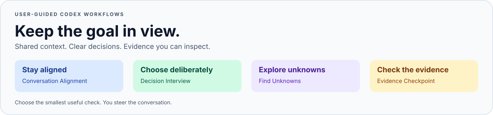

# Codex Adaptive Workflow

**Keep Codex focused on the outcome you actually want.**

[](https://github.com/sgjche/codex-adaptive-workflow/releases)
[](docs/INSTALLATION.md)
[](LICENSE)

Codex Adaptive Workflow grew out of [Latent Space’s discussion of Claude Code](https://latent.space/p/thariq)
with **swyx** and **Thariq Shihipar** of Anthropic—and a familiar frustration:
an agent can keep solving local problems while losing sight of the outcome
you wanted.

This **independent project inspired by that discussion** adapts ideas about
clarification, finding unknowns, and reassessing next steps into four focused
Codex skills. A shared project brief preserves context, while selective checks
help surface consequential questions and inspect important claims. You
continue to guide the conversation.



[Quick start](#quick-start) · [Use cases](#use-cases) ·
[Inspiration](#inspiration-and-design-choices) · [Example prompts](docs/EXAMPLES.md) ·
[Installation guide](docs/INSTALLATION.md) · [Contributing](CONTRIBUTING.md)

## Why this exists

A long task can drift without an obvious failure. The agent keeps fixing the
latest error, a provisional assumption turns into a requirement, or a passing
helper check becomes the definition of “done.”

Codex Adaptive Workflow adds a shared project brief and a few focused checks:

- **Keep the outcome visible.** Recover accepted decisions and protected work
  when returning to a project.
- **Ask about decisions that matter.** Clarify consequential choices without
  repeating a long intake interview.
- **Investigate the right uncertainty.** Check an assumption that could change
  the next action.
- **Make important claims inspectable.** Connect completion criteria to actual
  artifacts, observations, and checks.

Use it around coding, research, data analysis, and other substantive project
work. Simple tasks can stay simple.

## Quick start

**Requirements:** Codex and Python 3.9+. The installer uses the Python standard
library; macOS is the validated platform.

Clone the released version, validate it, and preview the changes:

```sh
git clone --branch v0.1.0 https://github.com/sgjche/codex-adaptive-workflow.git
cd codex-adaptive-workflow
python3 workflow.py validate
python3 workflow.py plan --mode selective
```

Review the plan, then install:

```sh
python3 workflow.py install --mode selective
python3 workflow.py verify
```

Prefer explicit invocation? Use `--mode manual` for both the plan and install
commands. Conversation Alignment remains available for substantive project work
in either mode. [Download the release ZIP](https://github.com/sgjche/codex-adaptive-workflow/releases/tag/v0.1.0)
if you prefer not to clone.

**Already have copies of these skills?** The installer refuses conflicting
unmanaged files. See [installation and recovery](docs/INSTALLATION.md) before
changing an existing setup.

## Try it on a real project

In a Codex project chat:

```text
$conversation-alignment
Recover our agreed outcome, accepted decisions, and current checkpoint from
the project brief. Then continue the change we already agreed to, preserving
the outputs we accepted.
```

For persistent continuity, keep a `PROJECT_BRIEF.md` with the project. Start
with the [blank brief template](skills/conversation-alignment/assets/PROJECT_BRIEF.template.md)
or ask Codex to prepare one from the decisions already made in your chat.
A brief records context; your latest explicit instructions govern the work.

## The four skills

| Skill | Reach for it when… | What it helps produce |
| --- | --- | --- |
| [Conversation Alignment](skills/conversation-alignment/SKILL.md) | A substantive project continues across sessions or changes direction. | A current reading of the agreed outcome, constraints, and relevant checkpoint. |
| [Decision Interview](skills/decision-interview/SKILL.md) | An unanswered user choice could materially change the approach. | A bounded set of questions with concrete alternatives and tradeoffs. |
| [Find Unknowns](skills/find-unknowns/SKILL.md) | A consequential assumption can be checked against evidence. | Up to three material findings, their evidence, and the next useful check. |
| [Evidence Checkpoint](skills/evidence-checkpoint/SKILL.md) | An important claim has conflicting evidence, a suspected shortcut, or changed acceptance checks. | A comparison between what was promised and what the available evidence establishes. |

These are separate tools. Choose the smallest useful action; there is no
required sequence.

## Use cases

| Your situation | A useful starting point |
| --- | --- |
| **A refactor runs across several days.** You need to preserve compatibility and work already accepted. | Conversation Alignment recovers the brief and protected constraints before the next change. |
| **A new feature has a consequential design choice.** Offline support, data retention, or the deployment target is unsettled. | Decision Interview separates user preferences from facts the agent can inspect. |
| **A scientific or data pipeline rests on an assumption.** Units, run boundaries, or an exclusion rule might change the result. | Find Unknowns investigates that specific boundary and reports the remaining uncertainty. |
| **Debugging has become a loop.** Local fixes keep accumulating without evidence that the original issue is solved. | Find Unknowns examines the assumption behind the loop; alignment keeps the intended outcome in view. |
| **You are about to share a result.** A test passes, but a required artifact or real interaction may still be missing. | Evidence Checkpoint checks the delivery claim against the actual completion criteria. |

See [worked examples](docs/EXAMPLES.md) for copyable prompts, expected outputs,
and examples of when to skip a skill. These are illustrative workflows, not
measured performance claims.

## Automatic or manual: your choice

| Mode | Conversation Alignment | The three process skills |
| --- | --- | --- |
| `selective` | Used for substantive ongoing project work; quiet when aligned. | Codex may select one when it meets a distinct material need. |
| `manual` | Same alignment policy. | Explicit invocation only. |

Automatic use of a process skill is instructed to announce itself once:

> Skill: Find Unknowns — checking whether timestamps use seconds or milliseconds.

Routine questions and checks should stay lightweight. The policy avoids a
fixed skill sequence, duplicate validation, and full-transcript reviews by
default. The package installs instructions and files; it starts no background
supervisor or recurring task. Independent reviewer agents require an explicit
human request.

Selection and notices are model-guided, so they can be missed or overused.
[Report an example](CONTRIBUTING.md#reporting-a-workflow-problem) if that happens.

## Inspiration and design choices

The [Latent Space interview, *Claude Code’s Next Era*](https://latent.space/p/thariq)
features **Thariq Shihipar** of Anthropic in conversation with **swyx** and
Vibhu. Around **42–44 minutes**, swyx discusses his next-step skill and
reminders about the user’s goal; Thariq explores how a forked agent could
provide supervisor-style guidance.

This is an independent adaptation of ideas from that discussion. Four choices
shape the Codex workflow:

- **A shared brief for continuity.** Recover the latest endorsed outcome,
  accepted decisions, and relevant evidence from a concise project brief.
- **The user guides each next step.** Follow the latest explicit steering,
  preserve accepted work, and return control when the current request is done.
- **Checks are selected for a material need.** Clarify a consequential choice,
  investigate an important assumption, or inspect a delivery claim. Prefer
  an ordinary question or check when it suffices.
- **Independent reviewers stay manual.** Additional reviewer agents require
  an explicit human request.

The supervisor architecture discussed in the episode remains a separate
direction. The current package implements the shared brief and skill checks
described here.

## Documentation

- [Worked examples](docs/EXAMPLES.md): realistic tasks, prompts, and skill selection.
- [Installation and recovery](docs/INSTALLATION.md): modes, paths, conflicts, and rollback.
- [Validation record](VALIDATION.md): what has been tested and what remains unknown.
- [Contributing](CONTRIBUTING.md): useful reports, local checks, and project scope.
- [Changelog](CHANGELOG.md): released work and unreleased documentation changes.

## Status and scope

**Experimental.** Installer and rollback checks have passed on two Macs, and
the package includes 21 installer tests. These checks establish packaging
behavior. Reliable automatic selection, Desktop compaction recovery, and
improved outcomes on multi-day tasks remain unverified.

The current package targets Codex. Claude Science support and a plugin wrapper
are deferred. The released `v0.1.0` tag and ZIP remain the reproducible install
target while `main` can receive documentation improvements.

## Contributing

Useful contributions include clear examples, narrower activation descriptions,
installer fixes, and reports of drift, missed activation, or unnecessary
interruption. Read [CONTRIBUTING.md](CONTRIBUTING.md) before making a broad
workflow change.

## License

[MIT](LICENSE). Original notices are preserved inside each skill.
